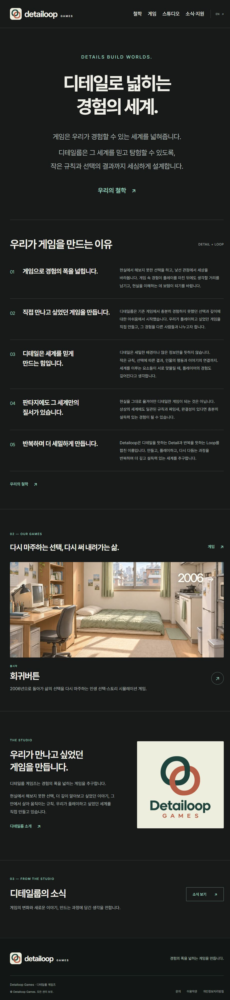
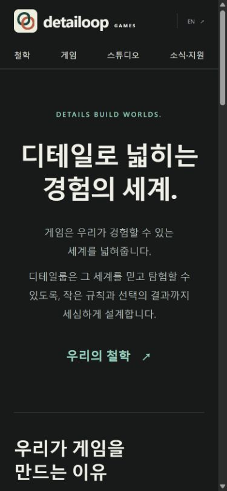

# 디테일룹 게임즈 · Detailoop Games

디테일룹 게임즈의 한국어·영어 공식 웹사이트입니다. 게임 소개와 스튜디오의 제작 방향, 소식과 지원 정보를 한곳에서 볼 수 있게 구성했습니다.

[한국어 홈페이지](https://detailoopgames.com/ko/) · [English website](https://detailoopgames.com/en/) · [《회귀버튼》 소개](https://detailoopgames.com/ko/games/hoegwi-button/)

| 데스크톱 미리보기 | 모바일 미리보기 |
| :---: | :---: |
|  |  |

## 역할과 운영

- 스튜디오의 방향과 브랜드 메시지, 게임을 소개하는 방식, 한국어·영어 콘텐츠의 구성과 공개 범위를 정했습니다. 제작 과정에서는 AI 도구를 활용해 사이트 초안과 화면을 구현하고, 결과를 보며 디자인과 문구를 수정했습니다.
- 게임 소개에서 설치 페이지로 이동할 수 있게 구성하고, Cloudflare Workers에서 공식 도메인을 운영합니다. 한국어와 영어에 별도 주소를 두고 첫 방문 경로를 지역에 맞춰 연결했습니다.
- Search Console에 사이트맵을 제출했습니다. `www` 접속은 Cloudflare에서 대표 주소로 301 이동하도록 설정했으며, 하위 페이지와 쿼리를 유지합니다.

## 소스와 기술

| 경로 | 역할 |
| --- | --- |
| [`src/pages/`](src/pages/) | Astro 정적 페이지, 다국어 경로, 사이트맵과 robots.txt |
| [`src/layouts/`](src/layouts/) · [`src/lib/site.ts`](src/lib/site.ts) | 페이지 공통 레이아웃, canonical, 소셜 메타데이터, 구조화 데이터 |
| [`src/data/`](src/data/) | 사이트 콘텐츠, 소식, 정책 데이터 |
| [`worker/video.mjs`](worker/video.mjs) | Cloudflare Workers에서 소개 영상의 범위 요청 처리 |

Astro, TypeScript, CSS, Cloudflare Workers를 사용합니다. 이 저장소에는 실행에 필요한 공개 소스와 사이트 자산을 담았습니다. 폰트 라이선스는 [public/fonts](public/fonts/)에 포함했습니다.

## 로컬에서 실행

Node.js 22.23.4 이상이 필요합니다. 검증에는 Node.js 24.19.0을 사용했습니다.

```sh
npm ci
npm run dev
```

터미널에 표시된 로컬 주소의 `/ko/` 또는 `/en/`을 엽니다.

```sh
npm run check
npm run build:public
```

공개 빌드와 페이지 검증 결과는 각각 `dist-public/`과 `dist-public-verification.json`에 생성됩니다.

Cloudflare 계정과 도메인에 종속된 배포 설정은 포함하지 않았습니다. 로컬 실행은 위 명령으로 가능하며, 별도 배포에는 자신의 계정과 배포 설정이 필요합니다.

## English summary

A bilingual studio website built with Astro and deployed on Cloudflare Workers. I defined the brand direction and content, reviewed design iterations, and managed the site’s release with AI-assisted implementation. The public source includes locale-specific routes, metadata, a sitemap, and the Worker for video delivery.
